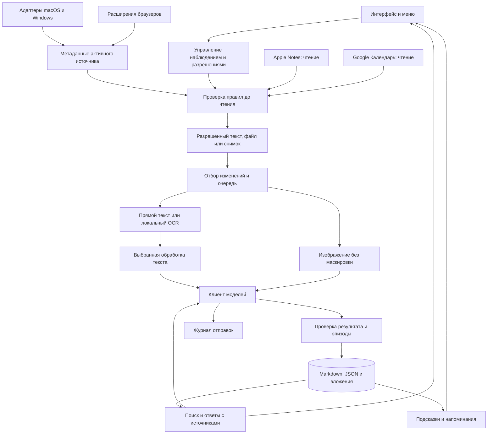

# Архитектура приложения

Версия: 0.1
Статус: согласована основа Electron + React, Python, файловая память Markdown/JSON с вложениями и SQLite для поиска/служебного состояния. Внешнее редактирование подтверждено; правила подхвата правок и конфликтов описаны в [EXTERNAL_EDITS.md](EXTERNAL_EDITS.md). Конкретные библиотеки, параметры и адаптеры ещё требуют проверки; компоненты не реализованы.

## Основное решение

Согласовано локальное десктопное приложение: Electron + React + TypeScript для интерфейса и меню/трея, отдельный Python-процесс для OCR, документов, памяти и моделей. Системный сбор изолирован в адаптерах macOS и Windows. Такой выбор позволяет использовать Python-библиотеки из исследования и общий интерфейс на обеих ОС. Цена решения — размер поставки Electron и упаковка двух сред исполнения; проверка сборок входит в первый технический этап.

Альтернатива при неудовлетворительной упаковке — Tauri с тем же Python-процессом; это резервное решение, не параллельная реализация. Версии зависимостей фиксируются после проверки сборки на обеих ОС. Отдельный облачный backend, аккаунты пользователей и синхронизация между устройствами для основной версии не нужны.

## Компоненты и границы

| Компонент | Ответственность |
| --- | --- |
| Desktop Shell | Жизненный цикл, меню/трей, уведомления, запуск локального процесса, системные диалоги |
| UI | Пять разделов, состояние наблюдения, источники, настройки и ошибки |
| Policy Engine | Единое решение разрешить/пропустить для приложения, сайта, чата, файла, импорта и внешнего запроса |
| Source Adapters | Метаданные и разрешённое содержимое конкретного источника; не принимают решения о внешней отправке |
| Capture Scheduler | Изменения, ограничение частоты, простой, пауза и очередь |
| Extractors | Текст интерфейса, OCR и разбор файлов; источник и координаты сохраняются отдельно от текста |
| Text Privacy | Выключено, локальный Presidio или серверный NeuralDeep; адаптеры не смешиваются незаметно |
| Model Gateway | Base URL, модель, секрет, возможности, тайм-ауты, повторы, протоколирование назначения |
| Memory Builder | Структурированный анализ и привязка фактов к исходным записям |
| Retrieval | Поиск по словам и смыслу, фильтры, контекст ответа и проверка ссылок |
| Suggestions | Восемь типов подсказок, дедупликация, выбранное время напоминаний |
| Storage and Retention | SQLite, файлы, индексы, миграции, удаление, наблюдатель файлов, ревизии и конфликты, восстановление после сбоя |

Python-процесс общается с оболочкой через сообщения JSON по stdin/stdout; диагностические логи идут отдельно. Контракт сообщений содержит версию, request_id, тип, payload и ошибку. Рендерер Electron не получает Node.js и ключи моделей; context isolation включён. HTML источников очищается перед отображением. Открытие URL и файлов выполняется через проверенный обработчик пользовательского действия, не через произвольную команду из текста модели.

Расширения используют Native Messaging и проверенные идентификаторы расширений. Локальный HTTP API по умолчанию не нужен. Если прототип потребует localhost-мост, он привязывается только к loopback, проверяет origin и секрет сессии; наличие localhost само по себе не является авторизацией.

## Получение данных

Адаптер сначала возвращает минимум: приложение, идентификатор окна и доступный адрес страницы. После разрешения читает содержимое. Окно и активная вкладка перепроверяются после захвата: если источник сменился, кадр отбрасывается. Полноэкранная обрезка не считается равнозначной захвату окна, поскольку может содержать перекрывающие уведомления. Неподдерживаемый захват отмечается явно.

Приоритет текста: прямой доступ к разрешённому интерфейсу/странице, затем чтение разрешённого файла, затем OCR. Визуальный режим может добавить изображение для таблиц и графиков. Чтение всего файла не запускается только по совпадению заголовка окна; нужны подтверждённый путь и доступ к файлу/папке. Данные скрытых вкладок и закрытых чатов не предполагаются доступными.

Идентификатор события строится из источника, версии содержимого и времени наблюдения; контент-хеш помогает удалить повторы. При изменении контента начинается новая версия, а не перезапись доказательства старого ответа. Полный экран не записывается непрерывным видео.

## Режимы обработки

| Настройка | Значения | Поведение |
| --- | --- | --- |
| Вход модели | Текст / изображение | Текстовый режим не отправляет снимок; визуальный требует соответствующую модель |
| Обработка текста | Без маскировки / локальная / серверная | Серверная обработка сама является внешней отправкой |
| Адрес модели | Внешний endpoint / LM Studio | Токен необязателен для сервера, который не требует авторизации |
| Работа без сети | Выключена / включена | При включении блокируются внешние модели, NeuralDeep, Google и загрузки страниц; скрытого перехода в облако нет |

Настройки текстовой и визуальной моделей могут ссылаться на один endpoint, но проверяются отдельно. Ошибка OCR или отсутствие поддержки картинки не переключают режим без ведома пользователя. Для результатов модели предлагается JSON-схема: summary, suggested_task, facts, source_ids, uncertainty; факты без существующих source_ids не попадают в доказательные ответы. Модель не определяет время активности самостоятельно.

Пример пользовательского API: `base_url`, `model`, ссылка на секрет и признак поддержки изображений. Предлагается общий Chat Completions-адаптер с ограниченным набором параметров; варианты structured output проверяются по поставщику. Невалидный JSON допускает ограниченный повтор, затем сохраняется ошибка, а не фиктивный успешный эпизод.

## Хранилище

Пользователь добавил обязательное требование: все заметки и сохранённый контекст доступны человеку в обычных файлах, предпочтительно по датам. Предлагается Markdown для читаемого содержимого, JSON для структурированных деталей и обычные файлы изображений. Это источник истины долговременной памяти; прежнее предложение хранить её только в SQLite заменено. SQLite остаётся для восстанавливаемого индекса FTS5 и служебного состояния приложения. Поддерживаются внешние правки с переиндексацией и сохранением конфликтующих версий. Структура папок, запись и восстановление описаны в [файловом хранилище](STORAGE.md). Для смыслового поиска начальный вариант — локальные embeddings через SentenceTransformers и sqlite-vec; кандидат модели `intfloat/multilingual-e5-small` требует отдельной проверки русского поиска, лицензии и упаковки. Это предложение, не результат сравнительного теста. При несовместимости расширения SQLite использовать изолированный векторный модуль, сохранив тот же контракт и удаление по chunk_id.

Внешние правки обрабатывает наблюдатель файлов вместе со сверкой хешей. При расхождении приложение не перезаписывает файл человека: версия приложения сохраняется в `conflicts/`, обе версии индексируются, конфликт показывается в интерфейсе. Стабильный `id` сохраняет связи при переименовании и переносе. Перед принятием правки исходное содержимое сохраняется как версия. Детали, задержки и приёмка — в [правилах внешних правок](EXTERNAL_EDITS.md).

| Объект | Основные поля |
| --- | --- |
| Source | id, type, app/browser/profile, locator, permission_state |
| Observation | id, source_id, observed_at, captured_at, content_hash, source_version, capture_mode, policy_version |
| Artifact | id, observation_id, path, media_type, masking_state, bytes, expires_at |
| Chunk | id, observation_id, text, page/region, extraction_method, embedding_model_version |
| Episode | id, title, start/end, active_seconds, uncertainty, source_refs |
| Task | id, title, due_at, timezone, status, confirmed, source_refs |
| Note | id, body, origin, source_refs, user_edited, updated_at |
| FileRevision | id, entity_id, revision, path, content_hash, origin, created_at |
| Conflict | id, entity_id, base_revision, external_hash, app_hash, status, version_paths |
| CalendarEvent | provider_id, calendar_id, recurrence_instance, start/end, status, version |
| Suggestion | id, type, evidence_ids, dedup_key, shown_at, dismissed_at |
| ModelRequest | id, purpose, endpoint_without_secrets, model, privacy_mode, payload_refs, status, attempts |
| Job | id, type, source_refs, policy_version, state, retry_at |

Секреты API и OAuth хранятся через системное хранилище macOS/Windows. База контента находится в каталоге текущего пользователя; это не обещание собственного шифрования базы. Один координатор, наблюдатель файлов, атомарная запись и журнал операций согласуют файловую память и SQLite; транзакция SQLite не считается транзакцией файловой системы. При удалении создаётся отметка, запрещающая очереди заново индексировать удалённые данные; повторный импорт удалённого периода требует отдельного явного действия.

История адресов хранит observed_at посещения и imported_at загрузки. Для повторно прочитанной страницы добавляется fetched_at; её нынешнее содержимое не привязывается как историческое. Копии исходного текста в индексе и журнале подчиняются выбранной политике хранения.

## Поиск и накопление контекста

1. Запрос разбирается на текст и фильтры времени/приложения/задачи.
2. Поиск слов и смысловой поиск работают только по разрешённым и неудалённым записям; результат объединяется, например методом RRF.
3. Повторы соседних кадров сворачиваются, но ссылки на доказательства сохраняются. Предлагаемый предел контекста — 12 фрагментов, корректируется по размеру контекста модели.
4. Модель получает фрагменты с идентификаторами и отдельно инструкции; контент источников не исполняется как инструкция.
5. Ответ проверяется на существование ссылок. При нехватке доказательств выводится отсутствие данных или уточняющий вопрос.

Долговременные сводки связаны с первичными записями. Исправление пользователем группировки сохраняется отдельно и не перетирается следующим проходом. Внешняя модель векторизации не используется в локальном режиме. Смена модели embeddings запускает управляемую переиндексацию, а не смешивает несовместимые векторы.

## Предлагаемые стартовые настройки

Эти числа ещё не утверждены пользователем и подлежат проверке на устройствах.

| Параметр | Предложение |
| --- | --- |
| Проверка активного источника | Каждые 2 секунды или по системному событию |
| Минимальный интервал снимков одного источника | 10 секунд, только при изменении |
| Простой | После 120 секунд без активности не добавлять активное время |
| Анализ | Один активный запрос анализа, ограниченная очередь до 100 заданий |
| Повторы временных ошибок API | До 3 попыток с задержкой; 401/403 требуют исправления настройки |
| Хранение снимков | До 7 дней и до 2 ГБ, удаляется самое старое при достижении любого лимита |
| Полное содержимое журнала отправок | До 7 дней; метаданные запроса до 30 дней |
| Встречи | Напоминание за 10 минут; изменение/отмена отменяет старое напоминание |
| Дедупликация подсказок | Одна карточка на тип и набор доказательств; обновление вместо повторного уведомления |

При исчерпании места или очереди новые задания пропускаются с видимым счётчиком, а не создают неограниченную нагрузку. Пауза и изменение правил имеют приоритет над повторами. Время хранится в UTC с исходным часовым поясом; показывается локально.

## Проверки решений

До фиксации стека: сборка Electron + Python на Mac и Windows, захват разрешённого окна, чтение текста, доставка события из расширения, локальный OCR, локальная индексация, внешняя правка и конфликт, удаление. До заявления об интеграции: пройти матрицу [источников](INTEGRATIONS.md). До заявления о готовности продукта: критерии [ТЗ](SPECIFICATION.md). Ни один из этих прогонов пока не выполнен.
